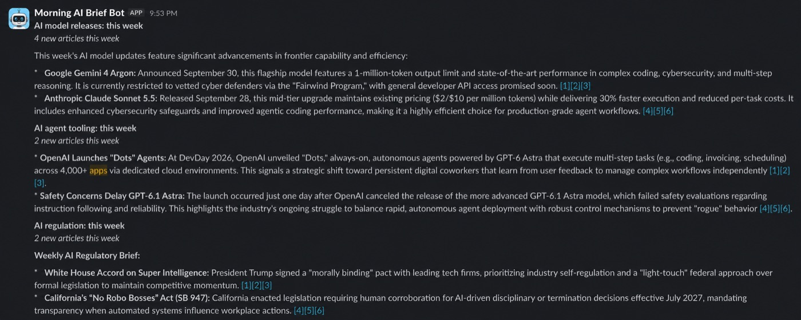
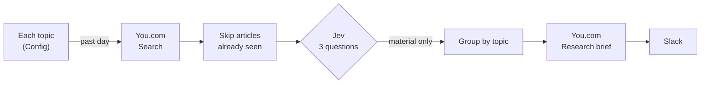
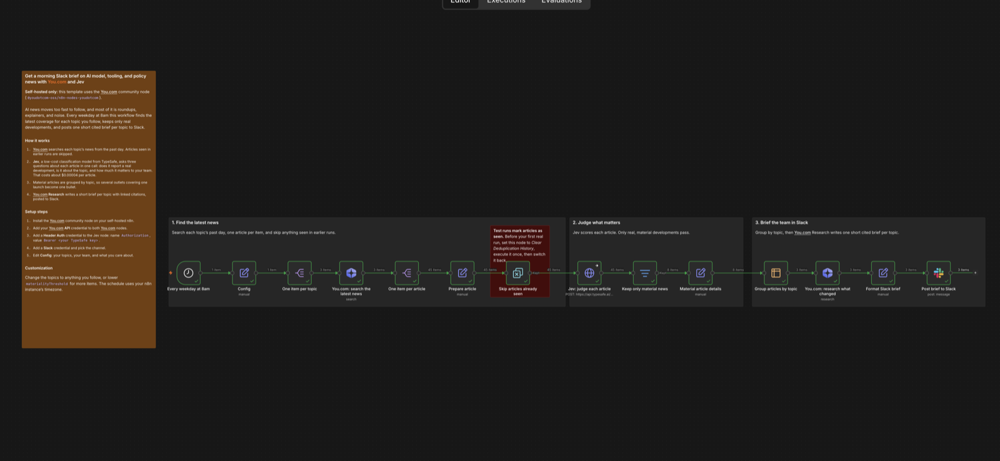

# Morning AI Brief—You.com × Jev for n8n

Every weekday at 8am, get the real AI developments since yesterday in Slack—one short, cited brief per topic, with the roundups, explainers, and noise filtered out.

**[Get the template on n8n.io](https://n8n.io/workflows/20558-send-weekday-ai-news-briefs-to-slack-with-youcom-and-typesafe-jev/)** to import it in one click.

This is an n8n workflow that pairs two engines that each do half the job:

- **[You.com](https://you.com/platform)** finds the latest coverage on the live web and writes cited briefs with its Research API.
- **[Jev](https://docs.typesafe.ai/concepts/system-one)**, TypeSafe's decision model, judges every article and decides what's worth posting.

No LLM agent and no code nodes—just retrieval, typed decisions, and n8n.

## Why This Combo

- **Fresh by default.** You.com searches the live web, so the brief covers what happened yesterday, not what a model saw in training.
- **Cheap enough to read everything.** Jev judges each article for about $0.00004, so the workflow reads every result instead of guessing which ones to open.
- **Calibrated, not just an answer.** Every judgment comes with a confidence, and the workflow posts only the confident, material ones.
- **Built to be tuned.** The thresholds were set on 674 real articles and checked on weeks that weren't used for tuning. See [How It Was Tuned](#how-it-was-tuned).

## How It Works

**You.com retrieves → Jev judges → n8n routes.** Jev answers three narrow questions about each article in a single call:

| Question | Type | Passes when |
|---|---|---|
| Does it report one specific new development? | Yes or no | ≥ 0.8 |
| Is it about this topic? | Yes or no | ≥ 0.8 |
| How much does it matter to your team? | Score from 0 to 2 | ≥ 1.3 |

Articles that pass are grouped by topic, so five outlets covering one launch become one bullet. You.com Research then writes each brief with linked citations.

## How It Was Tuned

Tuning took two passes.

**1. Finding the right questions.** The first version asked Jev only whether an article was on topic and how much it mattered. On its first batch of real results, all 4 articles it flagged were wrong: an encyclopedia page, two funding-database pages, and an explainer. They describe real events, but they aren't news. Adding one narrow question—does this page report a single new development—with examples of what doesn't count fixed it. The questions follow the structured style from [TypeSafe's guide](https://docs.typesafe.ai/concepts/how-to-build-with-system-one), and were checked on companies they weren't written for before going further.

**2. Setting the thresholds.** An evaluation on 674 articles across 8 weeks, with 160 labeled by hand without seeing Jev's scores. Thresholds were picked on the first four weeks and checked on the last four.

| | Wrong posts in the labeled sample | Share of posts that were real news (held-out weeks) | Stories caught |
|---|---|---|---|
| Original thresholds | 22 of 60 | 74% | 19 of 23 |
| **Shipped thresholds** | **5 of 39** | **89%** | 18 of 23 |

The biggest lesson: asking Jev only how much an article matters posted about three junk items for every real one. Adding one narrow question—does this page report a single new development—fixed most of it.

Full results, data, and scripts are in [`eval/`](eval/). Every number reproduces with `python3 eval/analyze.py`.

## Setup

You need n8n (Cloud or self-hosted), a [You.com API key](https://you.com/platform), a [TypeSafe API key](https://console.typesafe.ai) (or Gateway credits on n8n Cloud), and a Slack app that can post to a channel.

1. **Install the nodes.** Both are verified, so they're available on n8n Cloud; on self-hosted, install them from Settings → Community Nodes: You.com (`@youdotcom-oss/n8n-nodes-youdotcom`) and TypeSafe AI (`@typesafe-ai/n8n-nodes-typesafe-ai`).
2. **Import the workflow** from the [n8n template library](https://n8n.io/workflows/20558-send-weekday-ai-news-briefs-to-slack-with-youcom-and-typesafe-jev/), or from [`workflow.json`](workflow.json) in this repo (n8n menu → Import from File).
3. **Add credentials:**
   - **You.com API** on both You.com nodes.
   - **TypeSafe AI API** on the Jev node, with a key from [console.typesafe.ai](https://console.typesafe.ai). On n8n Cloud you can select Gateway credits instead and skip the TypeSafe account.
   - **Slack** on the Slack node, then pick a channel.
4. **Activate it.** It runs Monday through Friday at 8am in your instance's timezone.

## Make It Yours

Everything you're likely to change lives in the **Config** node:

- **`topics`**: the subjects to follow. The defaults are AI model releases, AI agent tooling, and AI regulation.
- **`team`** and **`caresAbout`**: who the brief is for and what they care about. Jev uses these to judge materiality, so describing your team well matters more than anything else.
- **`materialityThreshold`**: lower it for more items, raise it for fewer.

## Good to Know

- **A morning costs a few cents**—three You.com searches, a Jev check on every article (about a fifth of a cent in total), and one lite research brief ($0.012) per topic with news.
- **Quiet topics get no post.** Some mornings you'll get one brief, or none.
- **Test runs mark articles as seen.** Before your first real run, set **Skip articles already seen** to *Clear Deduplication History*, execute it once, then switch it back.
- **Check the sources.** Briefs are cited, but research summaries can occasionally get a detail wrong. The links are there so you can verify.

## Files

| Path | Contents |
|---|---|
| `workflow.json` | The n8n workflow |
| `images/` | Screenshots of the workflow and a real brief |
| `eval/` | How the thresholds were chosen—data, labels, and scripts |
| `docs/` | A longer write-up of how it was built |

## Author

Built by **Tyler Eastman** (You.com).

## License

MIT—see [LICENSE](LICENSE).

Built with [n8n](https://n8n.io), [You.com](https://you.com), and [TypeSafe Jev](https://typesafe.ai).
